# Lab 02 — Active Directory Users, Groups & Organizational Units

## Project Overview

This lab demonstrates enterprise user account administration, security group management, organizational unit design, and identity lifecycle management using Active Directory Domain Services (AD DS).

The objective is to simulate real-world IT administration tasks within a fictional company, WilyTech, using Active Directory Users and Computers (ADUC) and PowerShell.

## Lab Environment

| Component | Configuration |
|---|---|
| Hypervisor | VMware Workstation |
| Server OS | Windows Server 2022 |
| Domain Controller | DC01 |
| Domain | ad.wilytech.test |
| Domain Controller IP | 192.168.72.10 |
| Client OS | Windows 11 Pro |
| Client Computer | PC01 |
| Management Tools | ADUC and PowerShell |

## 1. Organizational Unit Structure

Created a dedicated organizational unit named WilyTech-Operations with four departmental OUs, maintaining the existing Active Directory infrastructure.

```text
WilyTech-Operations
├── Finance
├── Marketing
├── Customer-Service
└── IT-Support
```

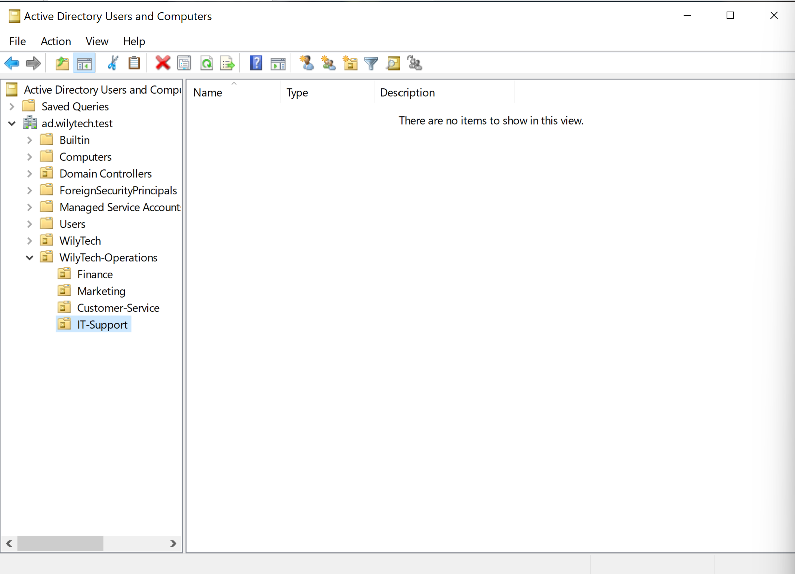

## 2. User Account Provisioning

Created eight user accounts across four departments to simulate employee onboarding.

| Employee | Original Department |
|---|---|
| Daniel Rivera | Finance |
| Laura Mendez | Finance |
| David Cruz | Marketing |
| Sofia Reyes | Marketing |
| Gabriel Santos | Customer Service |
| Isabel Torres | Customer Service |
| Michael Garcia | IT Support |
| Andrea Lopez | IT Support |

### Finance Department

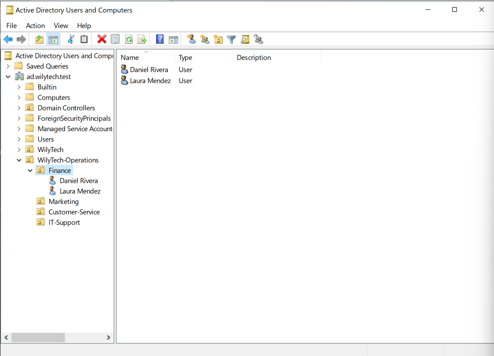

### Marketing Department

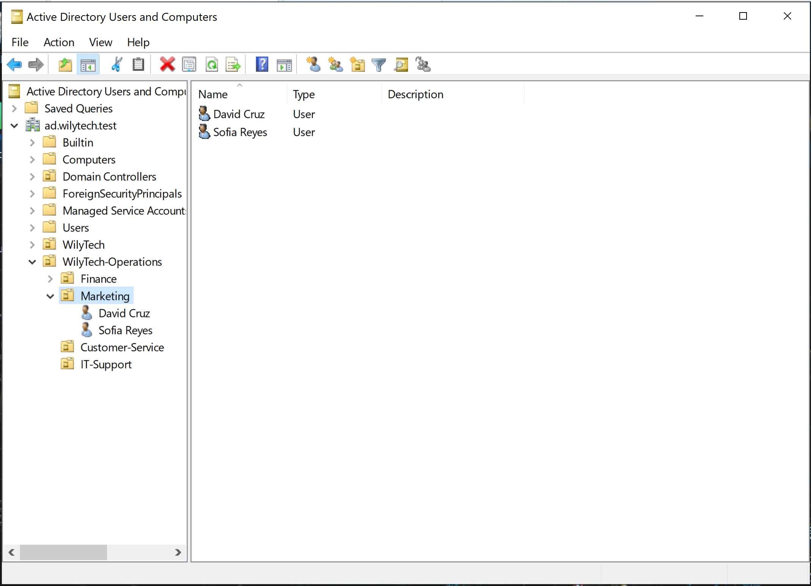

### Customer Service Department

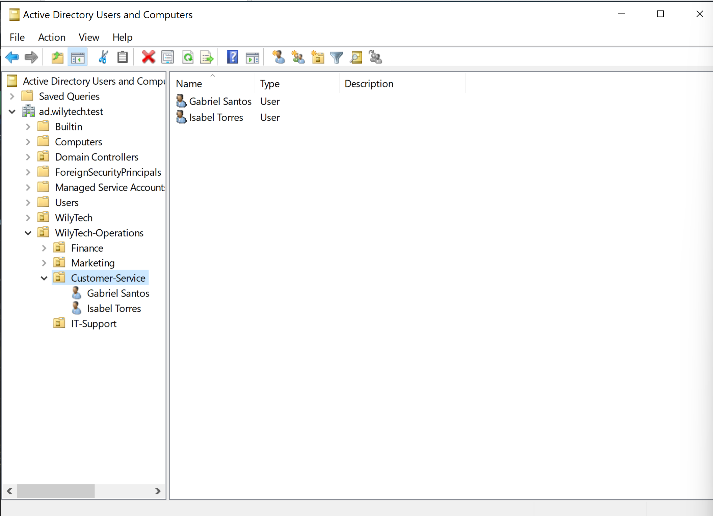

### IT Support Department

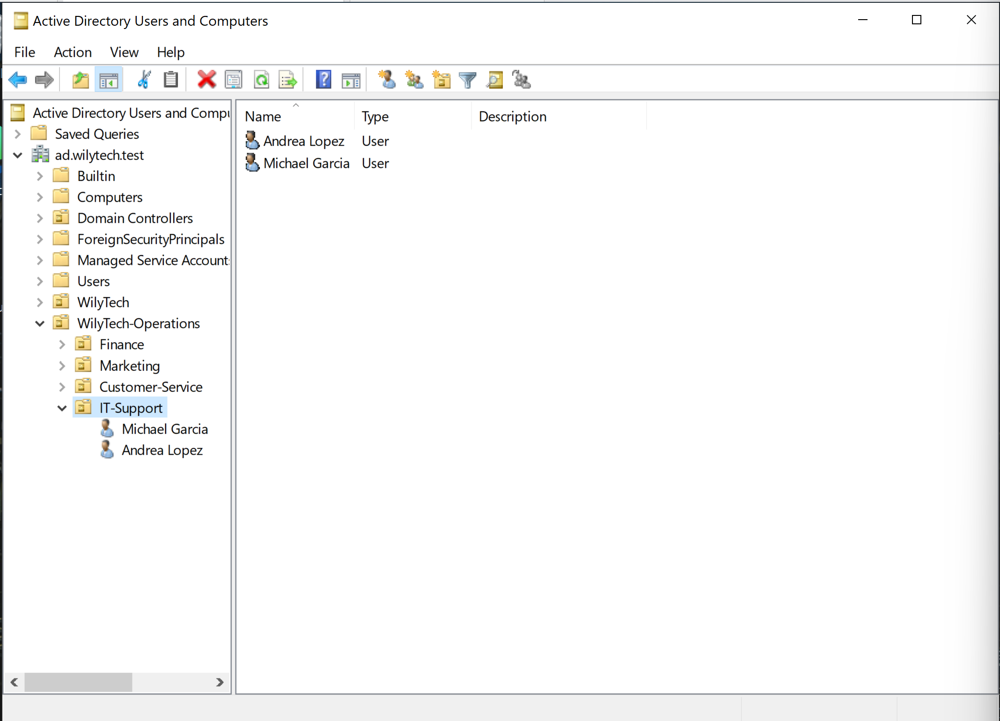

## 3. Security Group Management

Created departmental Global Security Groups to support centralized identity and access management.

Assigned users to their corresponding departmental security groups.

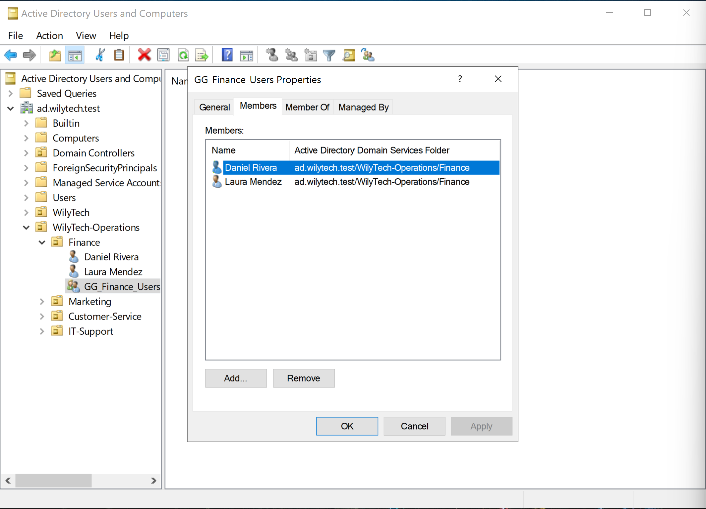

## 4. User Account Deactivation

Simulated an employee account deactivation by disabling Daniel Rivera's Active Directory account.

Disabling an account prevents new domain authentication without permanently deleting the user object.

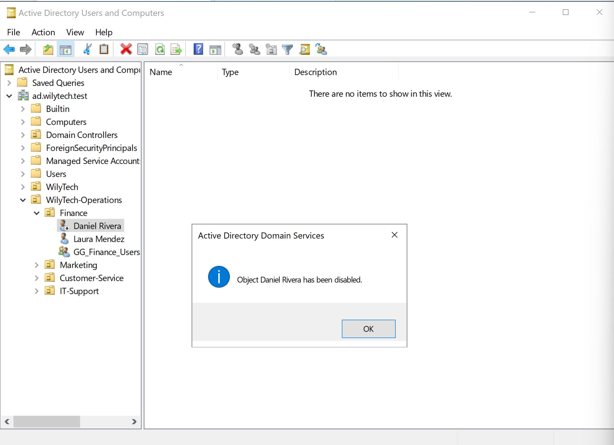

### PowerShell Verification

```powershell
Get-ADUser -Identity "daniel.rivera" |
Select-Object Name, SamAccountName, Enabled
```

The account status was successfully verified as Enabled: False.

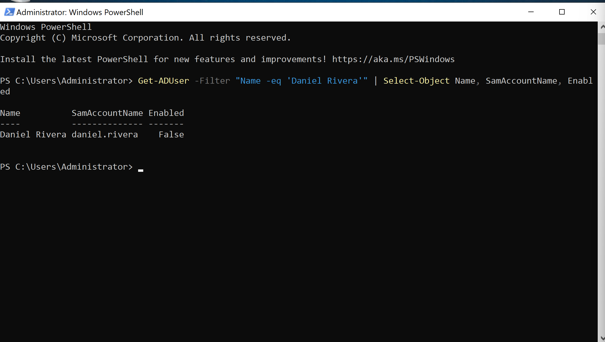

## 5. User Account Reactivation

Reactivated Daniel Rivera's account and verified its enabled status using PowerShell.

```powershell
Enable-ADAccount -Identity "daniel.rivera"
```

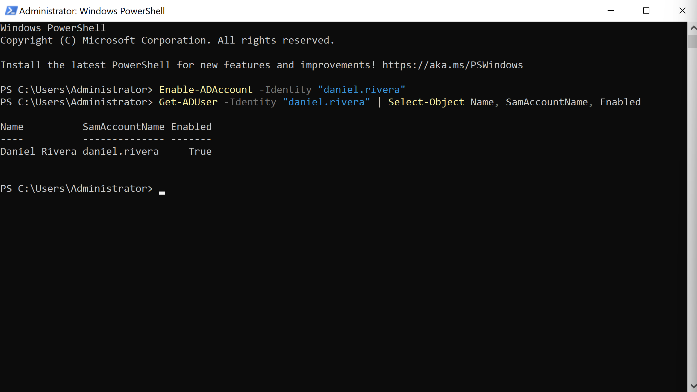

## 6. Password Reset Administration

Performed an administrative password reset for Laura Mendez and configured the account to require a password change at the next logon.

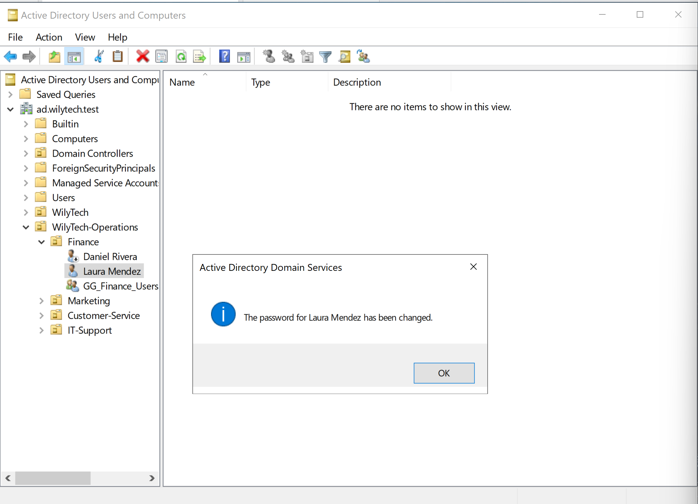

### Password Reset Verification

```powershell
Get-ADUser -Identity "laura.mendez" -Properties pwdLastSet |
Select-Object Name, SamAccountName, Enabled, pwdLastSet
```

The pwdLastSet value of 0 confirmed that the user was required to change the password at the next logon.

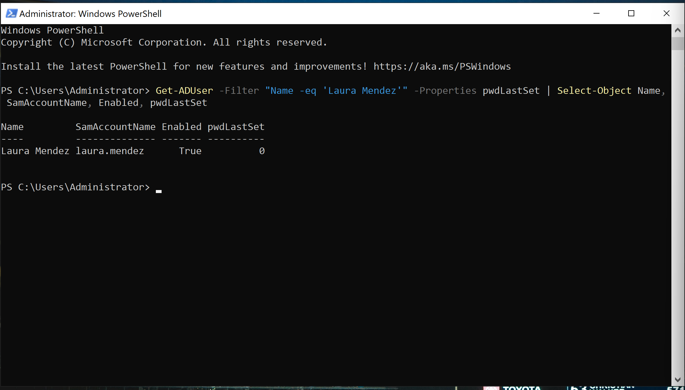

## 7. Group Membership Verification

Verified Laura Mendez's existing security group memberships before performing a departmental transfer.

```powershell
Get-ADPrincipalGroupMembership -Identity "laura.mendez" |
Select-Object Name, GroupScope, GroupCategory
```

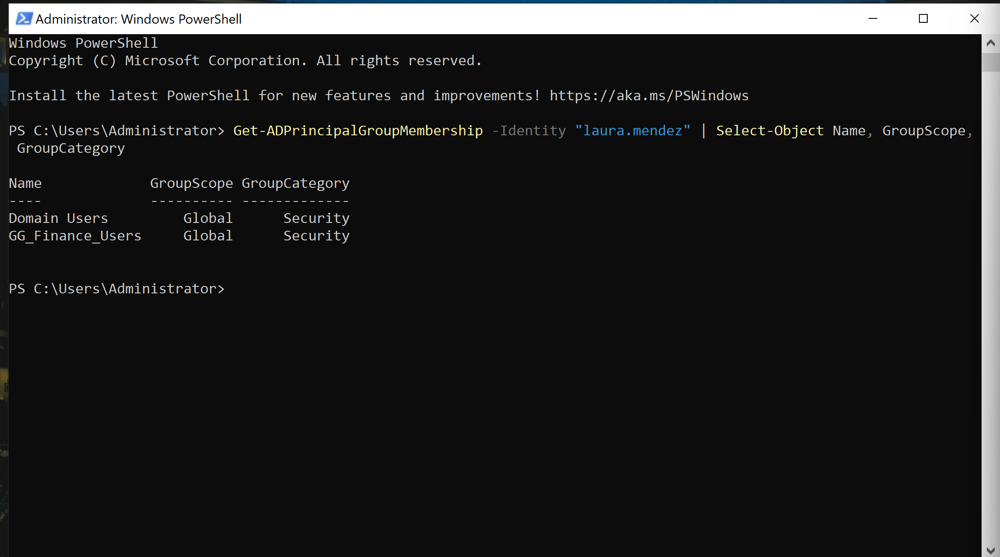

## 8. Employee Department Transfer

Simulated an internal employee transfer from Finance to Marketing.

Moved Laura Mendez's user object to the Marketing organizational unit.

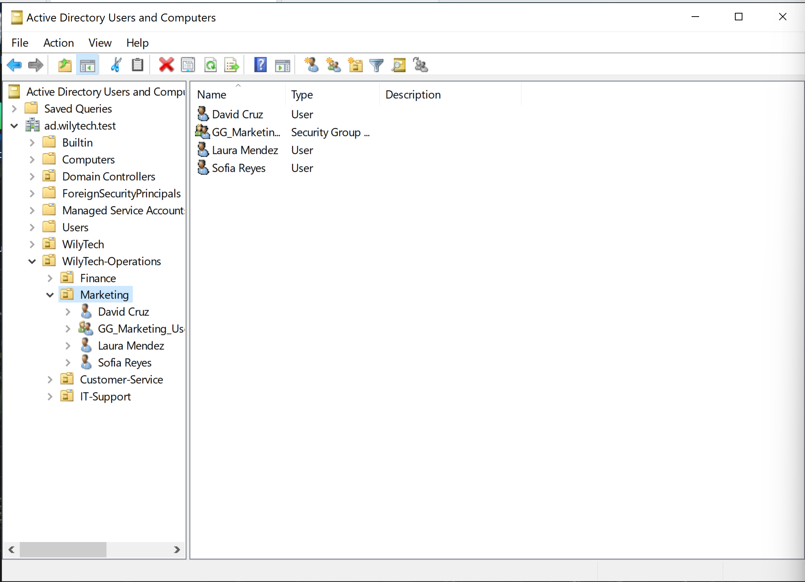

### Security Group Membership Update

Removed the employee from the previous departmental security group and assigned the appropriate Marketing security group.

```powershell
Remove-ADGroupMember -Identity "GG_Finance_Users" -Members "laura.mendez"

Add-ADGroupMember -Identity "GG_Marketing_Users" -Members "laura.mendez"

Get-ADPrincipalGroupMembership -Identity "laura.mendez" |
Select-Object Name, GroupScope, GroupCategory
```

This procedure demonstrates identity lifecycle management and the principle of least privilege by removing obsolete departmental group membership.

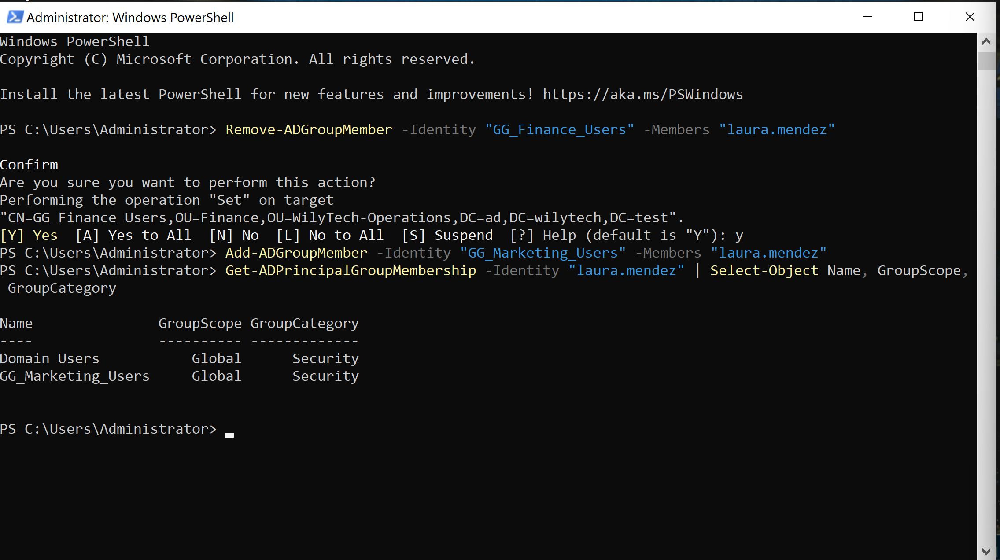

### Employee Attribute Management

Updated the employee's department, job title, and company attributes using PowerShell.

```powershell
Set-ADUser -Identity "laura.mendez" `
-Department "Marketing" `
-Title "Marketing Specialist" `
-Company "WilyTech"
```

Verified the updated attributes:

```powershell
Get-ADUser -Identity "laura.mendez" `
-Properties Department,Title,Company |
Select-Object Name,Department,Title,Company
```

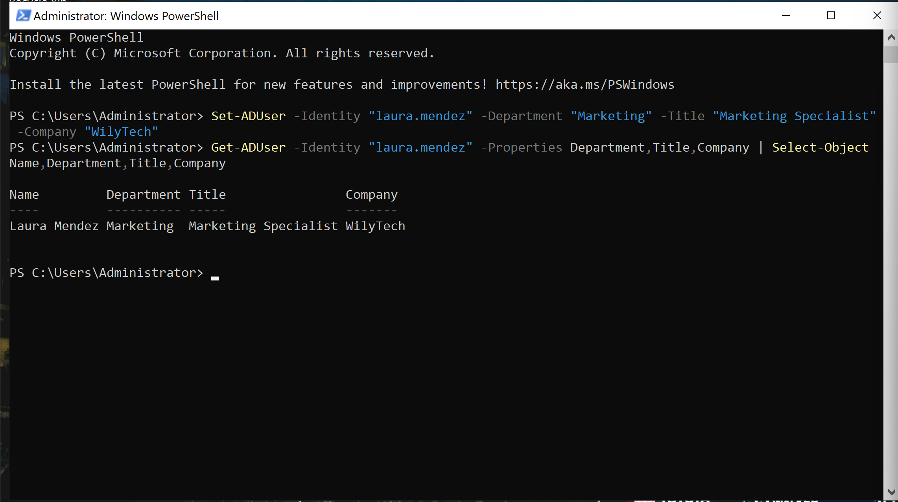

## 9. User Account Audit

Performed a scoped Active Directory user account audit to verify account names, usernames, enabled status, and department attributes.

```powershell
Get-ADUser -Filter * `
-SearchBase "OU=WilyTech-Operations,DC=ad,DC=wilytech,DC=test" `
-Properties Department |
Select-Object Name,SamAccountName,Enabled,Department |
Format-Table -AutoSize
```

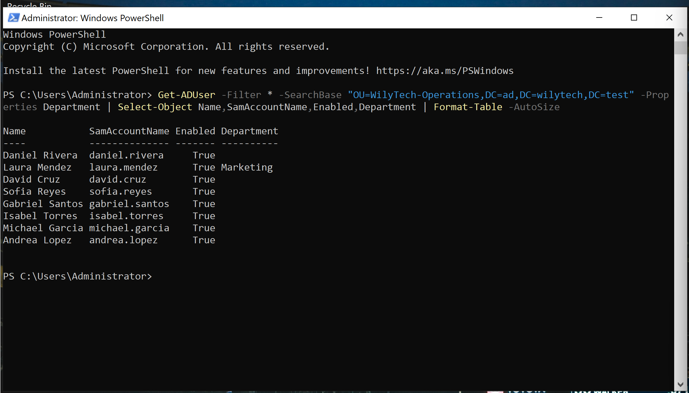

## Results

- Created one parent OU and four departmental OUs.
- Provisioned eight Active Directory user accounts.
- Created and managed departmental security groups.
- Successfully disabled and reactivated a user account.
- Performed and verified an administrative password reset.
- Completed an employee departmental transfer.
- Removed obsolete departmental group membership.
- Updated employee identity attributes.
- Verified all eight user accounts were enabled.
- Identified missing department attributes during the final account audit.

## Skills Demonstrated

- Active Directory administration
- Organizational Unit management
- User account provisioning
- Security group administration
- Identity and Access Management (IAM)
- Employee onboarding and account deactivation
- Identity lifecycle management
- Password reset administration
- PowerShell administration
- User account auditing
- Principle of least privilege
- Technical documentation

## Conclusion

This lab demonstrates practical Active Directory administration and identity lifecycle management in a simulated enterprise environment.

The exercises reflect common responsibilities performed by IT Support Specialists, System Administrators, and Identity and Access Management professionals.
