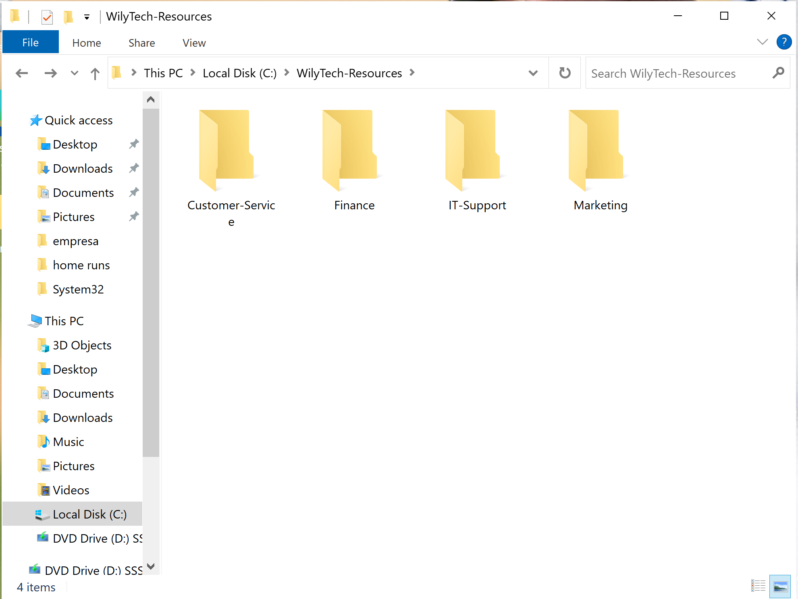
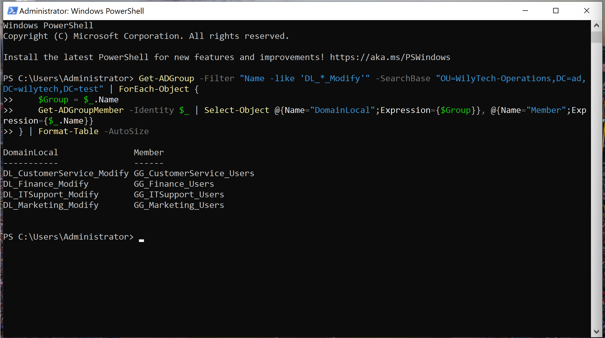
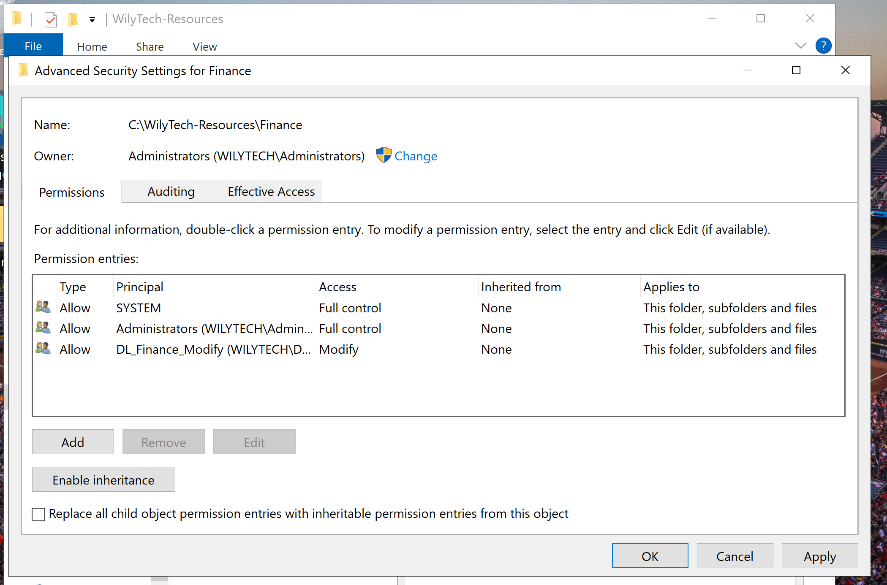
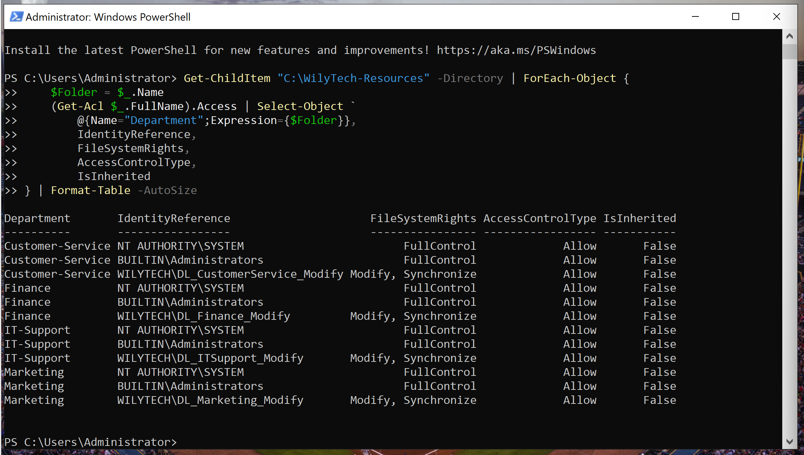
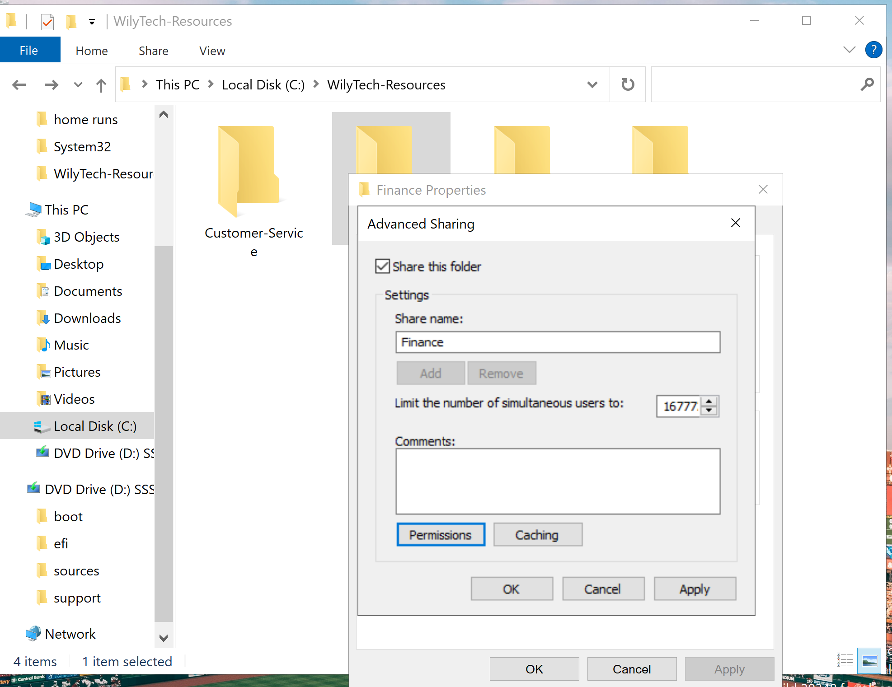
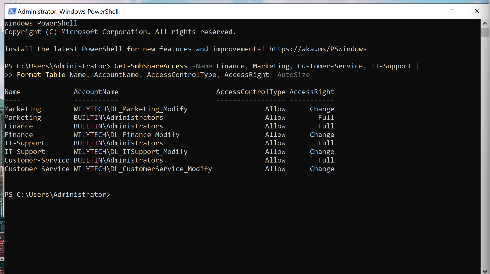
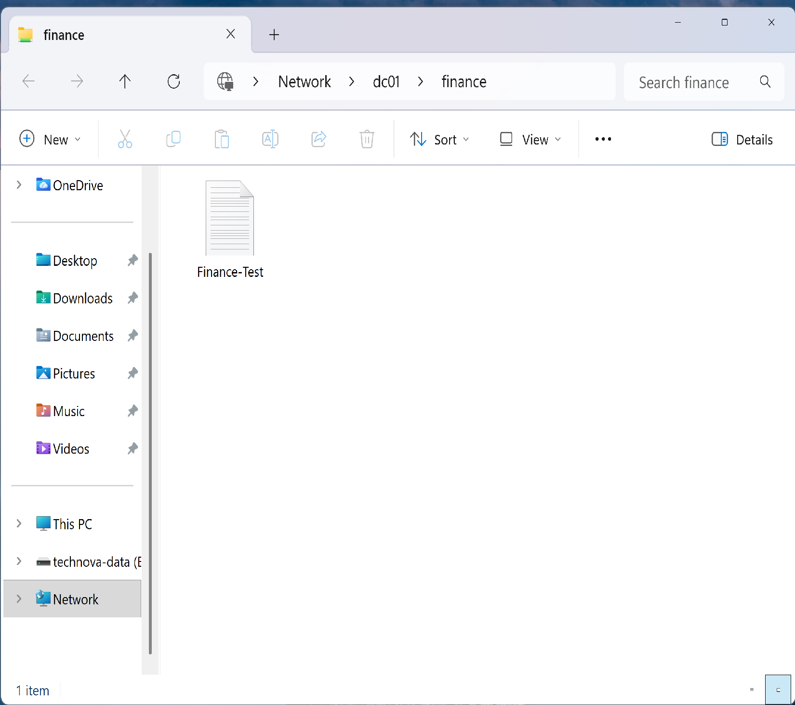
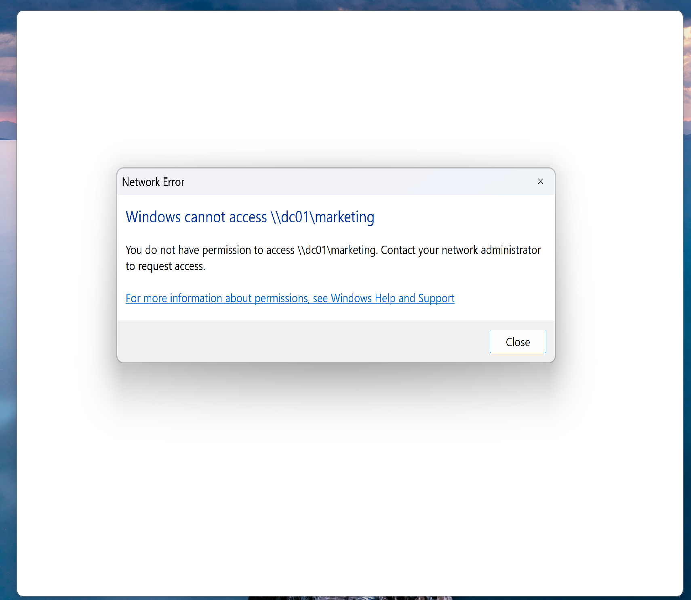
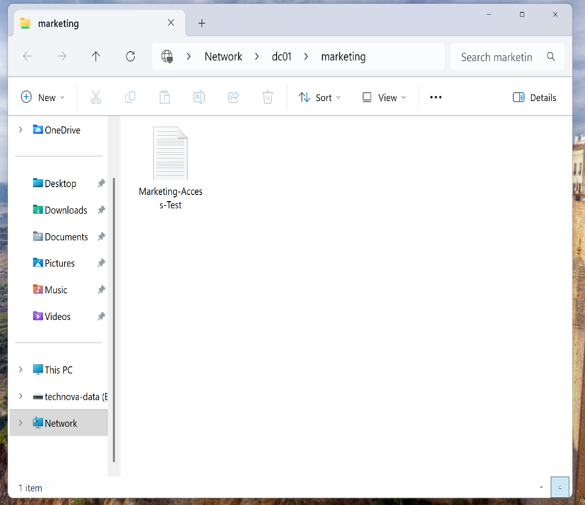

# Lab 03 – NTFS, SMB Permissions & AGDLP

## Project Overview

This lab demonstrates enterprise file access management using Active Directory security groups, NTFS permissions, SMB share permissions, and the AGDLP model.

The objective is to implement secure departmental resource access, enforce the principle of least privilege, and validate access permissions from a domain-joined Windows 11 workstation.

## Lab Environment

| Component | Configuration |
|---|---|
| Organization | WilyTech |
| Domain | ad.wilytech.test |
| Domain Controller | DC01 |
| Server OS | Windows Server 2022 |
| Client | PC01 |
| Client OS | Windows 11 Pro |
| Virtualization | VMware Workstation |
| Resource Path | C:\WilyTech-Resources |

## Technologies Used

- Active Directory Domain Services (AD DS)
- Windows Server 2022
- Windows 11 Pro
- NTFS Permissions
- SMB Share Permissions
- Active Directory Security Groups
- PowerShell
- AGDLP Access Control Model
- Identity and Access Management (IAM)

## 1. Departmental Resource Structure

Created a centralized resource directory containing four departmental folders:

- Finance
- Marketing
- Customer-Service
- IT-Support



## 2. Domain Local Security Groups

Created dedicated Domain Local security groups to manage resource permissions.

| Department | Domain Local Security Group |
|---|---|
| Finance | DL_Finance_Modify |
| Marketing | DL_Marketing_Modify |
| Customer Service | DL_CustomerService_Modify |
| IT Support | DL_ITSupport_Modify |


## 3. AGDLP Implementation

Implemented the AGDLP model:

- A – Accounts
- G – Global Groups
- DL – Domain Local Groups
- P – Permissions

Users were assigned to departmental Global security groups. These groups were nested inside the corresponding Domain Local security groups, which were assigned resource permissions.

| Global Group | Domain Local Group |
|---|---|
| GG_Finance_Users | DL_Finance_Modify |
| GG_Marketing_Users | DL_Marketing_Modify |
| GG_CustomerService_Users | DL_CustomerService_Modify |
| GG_ITSupport_Users | DL_ITSupport_Modify |

Verified group nesting using PowerShell.



## 4. NTFS Permissions Configuration

Configured explicit NTFS permissions for each departmental folder.

- Disabled permission inheritance.
- Removed unnecessary default user permissions.
- Retained SYSTEM and Administrators with Full Control.
- Assigned Modify permissions to the corresponding Domain Local security group.
- Applied permissions to folders, subfolders, and files.



## 5. NTFS Permissions Audit

Used PowerShell and the Get-Acl cmdlet to audit departmental access control lists.

Verified that:

- Each department had its corresponding security group.
- Departmental groups had Modify permissions.
- SYSTEM and Administrators retained Full Control.
- The configured permissions were explicit.



## 6. SMB Share Permissions

Configured individual SMB shares for all four departments.

- Removed the Everyone group.
- Assigned Change and Read permissions to departmental Domain Local groups.
- Assigned Full Control to Administrators.

| Security Principal | SMB Permissions | NTFS Permissions |
|---|---|---|
| Administrators | Full Control | Full Control |
| Departmental Security Group | Change | Modify |



## 7. SMB Permissions Audit

Verified SMB share permissions using PowerShell.

```powershell
Get-SmbShareAccess -Name Finance, Marketing, Customer-Service, IT-Support |
Format-Table Name, AccountName, AccessControlType, AccessRight -AutoSize
```

Confirmed that all four shares contained the appropriate departmental security group and Administrators.



## 8. Authorized Access Testing

Signed in to PC01 using the Finance employee account:

- User: Daniel Rivera
- Username: daniel.rivera
- Department: Finance

Accessed the departmental network share:

```text
\\DC01\Finance
```

Successfully tested file creation, modification, saving, and deletion.



## 9. Unauthorized Access Testing

Attempted to access resources belonging to other departments using the Finance employee account.

| Network Share | Test Result |
|---|---|
| Finance | Access Granted |
| Marketing | Access Denied |
| Customer-Service | Access Denied |
| IT-Support | Access Denied |

The results confirmed departmental resource isolation and enforcement of the principle of least privilege for the tested account.



## 10. Employee Transfer and Access Validation

Validated an employee department transfer as part of an Identity and Access Management lifecycle scenario.

### Employee Information

- Employee: Laura Mendez
- Username: laura.mendez
- Previous Department: Finance
- New Department: Marketing
- Job Title: Marketing Specialist

### Access Management Changes

- Removed membership from GG_Finance_Users.
- Added membership to GG_Marketing_Users.
- Validated updated resource access from PC01.

The employee successfully accessed the Marketing share and created a test document.



Access to the previous Finance department was denied.


This scenario demonstrates the Mover stage of the Joiner-Mover-Leaver (JML) identity lifecycle.

## Security Principles Demonstrated

- Principle of Least Privilege
- Group-Based Access Control
- Departmental Resource Isolation
- Access Provisioning
- Access Revocation
- Identity Lifecycle Management
- Permission Auditing
- Separation of Administrative and Standard User Access

## Skills Demonstrated

- Active Directory security group administration
- AGDLP implementation
- NTFS access control management
- SMB file sharing administration
- PowerShell permission auditing
- Network resource access troubleshooting
- User access validation
- Employee access lifecycle management
- Enterprise technical documentation

## Final Results

Successfully implemented and validated a group-based departmental file access model using Active Directory, NTFS, SMB, and AGDLP.

The tested Finance and Marketing employee scenarios produced the expected authorized and unauthorized access results.

Employee access was managed through Active Directory group membership without assigning individual user permissions directly to departmental folders.

## Lab Status

Completed – Configuration, auditing, and access validation successful.

## Author

Wily-IT-Labs

IT Support | System Administration | Identity and Access Management
