# Lab 04 - Group Policy Administration

## Project Overview

This lab demonstrates the implementation, administration, and troubleshooting of Group Policy Objects (GPOs) in a Windows Server 2022 Active Directory environment for WilyTech.

The objective was to centrally manage user restrictions, workstation security settings, and department-specific policies using Organizational Units and Security Filtering.

## Lab Environment

| Component | Configuration |
|---|---|
| Company | WilyTech |
| Domain Controller | DC01 |
| Server OS | Windows Server 2022 |
| Client Computer | PC01 |
| Client OS | Windows 11 Pro |
| Active Directory Domain | ad.wilytech.test |
| NetBIOS Domain | WILYTECH |

## 1. Group Policy Management

Accessed the Group Policy Management Console (GPMC) to manage centralized domain policies and review existing Group Policy Objects.

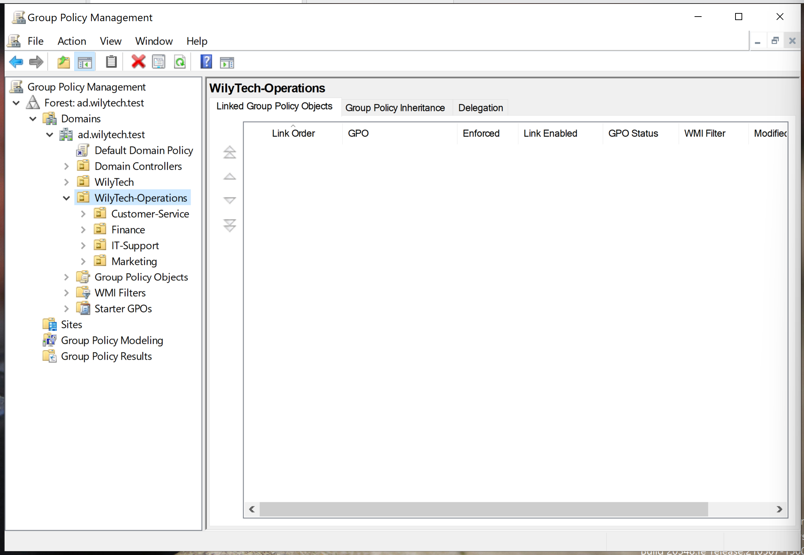

## 2. Finance Department - Control Panel Restriction

Created and configured the following GPO:

- GPO Name: GPO_Finance_Block_ControlPanel
- Target: Finance Organizational Unit
- Configuration Type: User Configuration
- Policy: Prohibit access to Control Panel and PC settings
- Status: Enabled

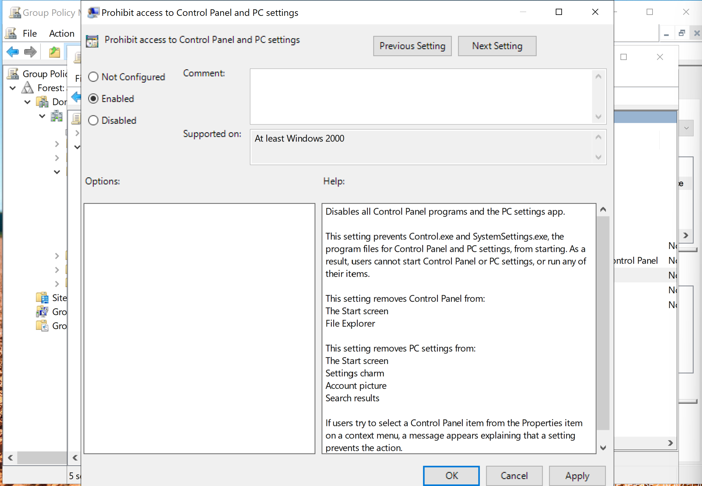

### Policy Application Verification

Updated and verified the Group Policy settings using:

```powershell
gpupdate /force
gpresult /r /scope user
```

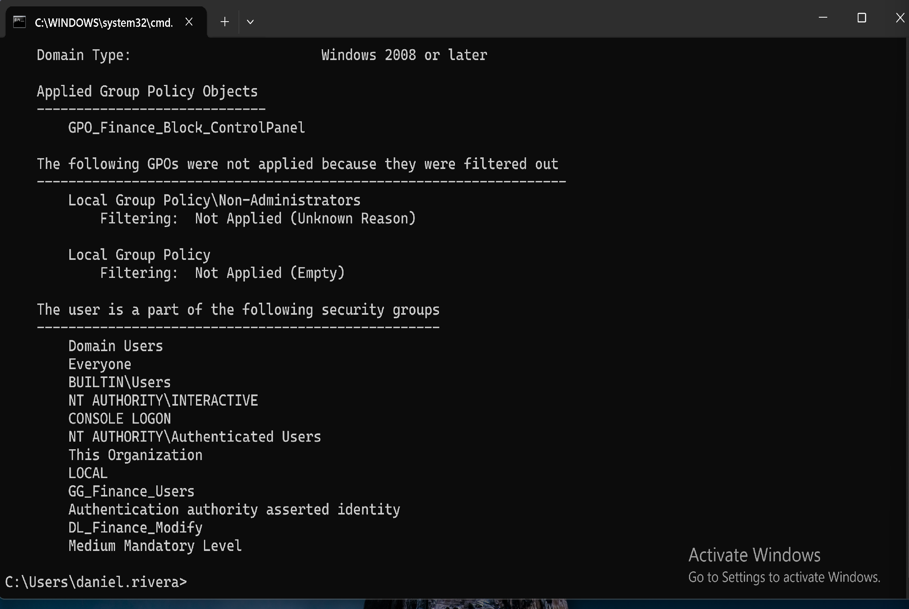

### Restricted User Access

Logged into PC01 as Daniel Rivera, a Finance department employee, and confirmed that access to Control Panel was blocked.

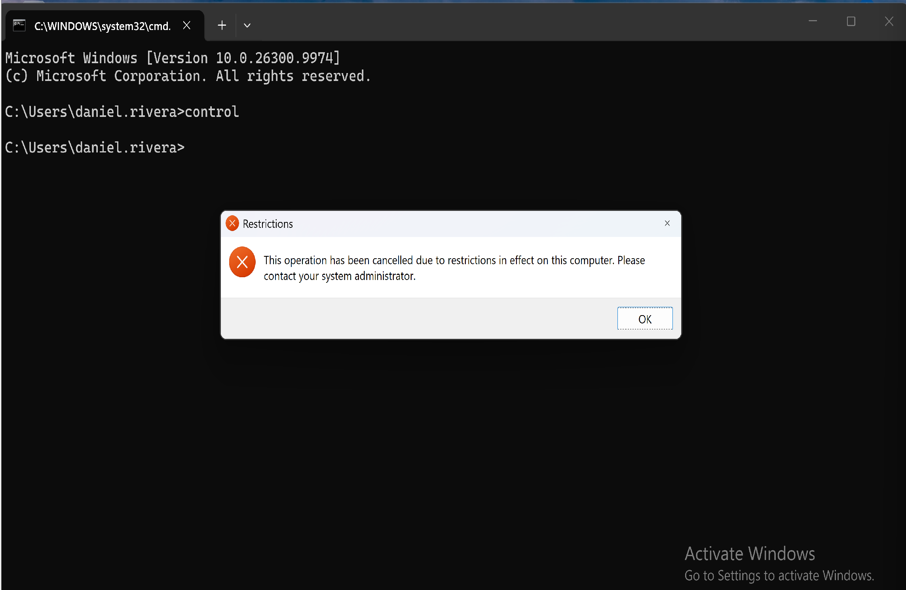

### Department Isolation Test

Logged into PC01 as Laura Mendez, a Marketing department employee, and confirmed that Control Panel remained accessible.

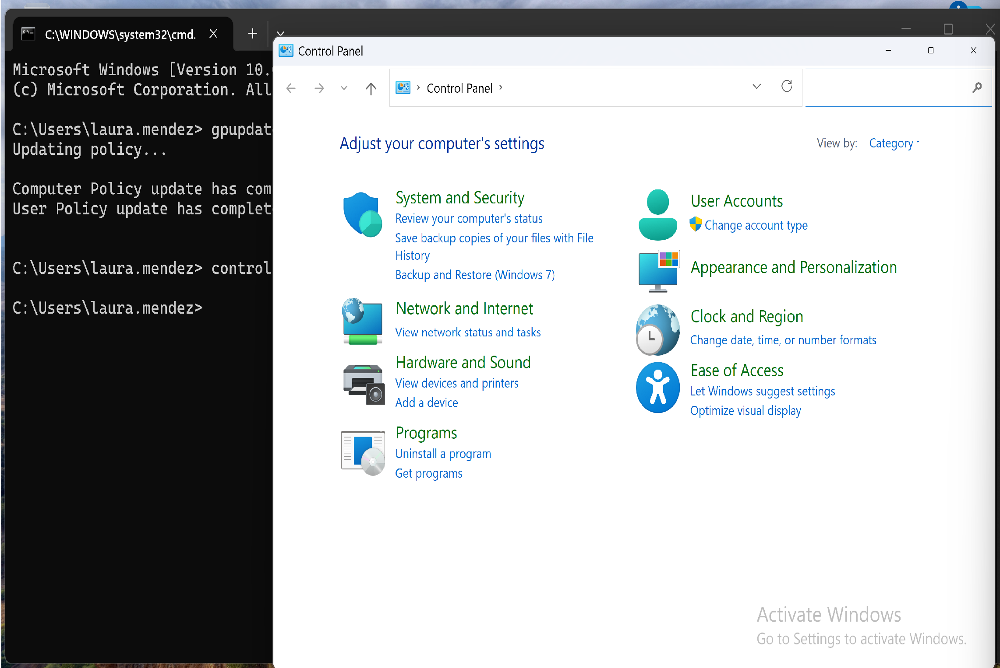

## 3. Workstation Security - Automatic Screen Lock

Created a dedicated Workstations Organizational Unit under WilyTech-Operations and moved PC01 into the new OU.

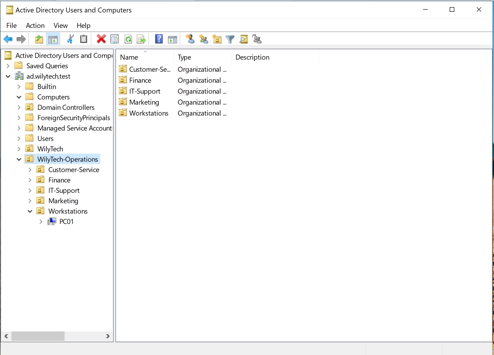

Created and configured the following computer-based GPO:

- GPO Name: GPO_Workstations_AutoLock_5Min
- Target: Workstations Organizational Unit
- Configuration Type: Computer Configuration
- Policy: Interactive logon: Machine inactivity limit
- Inactivity Timeout: 300 seconds (5 minutes)

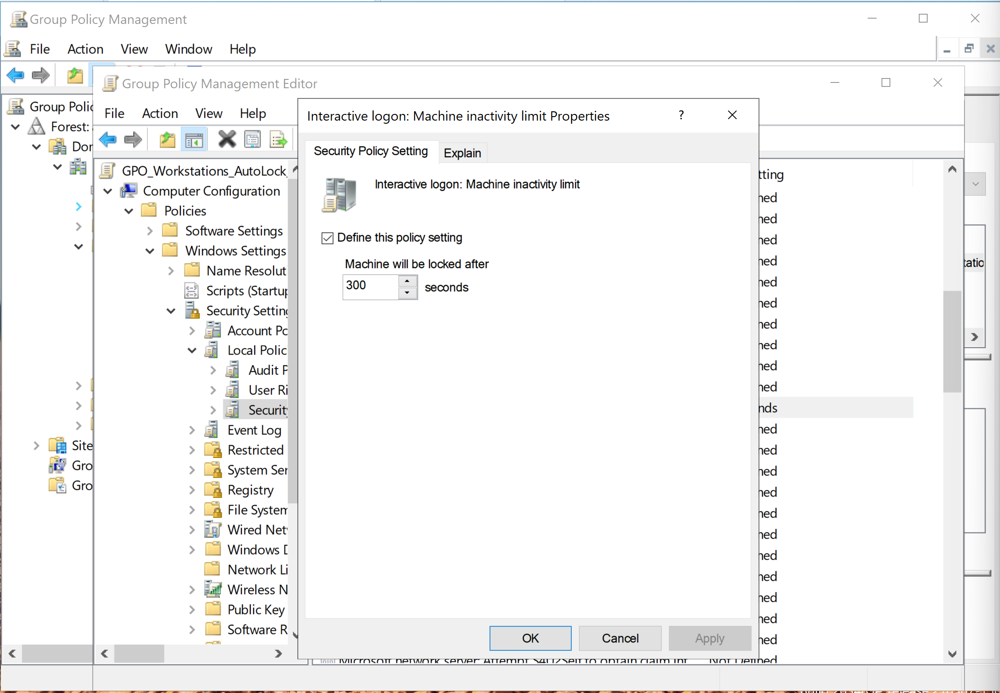

### Computer Policy Verification

Verified the computer policy using an elevated PowerShell session.

```powershell
gpupdate /force
gpresult /r /scope computer
```

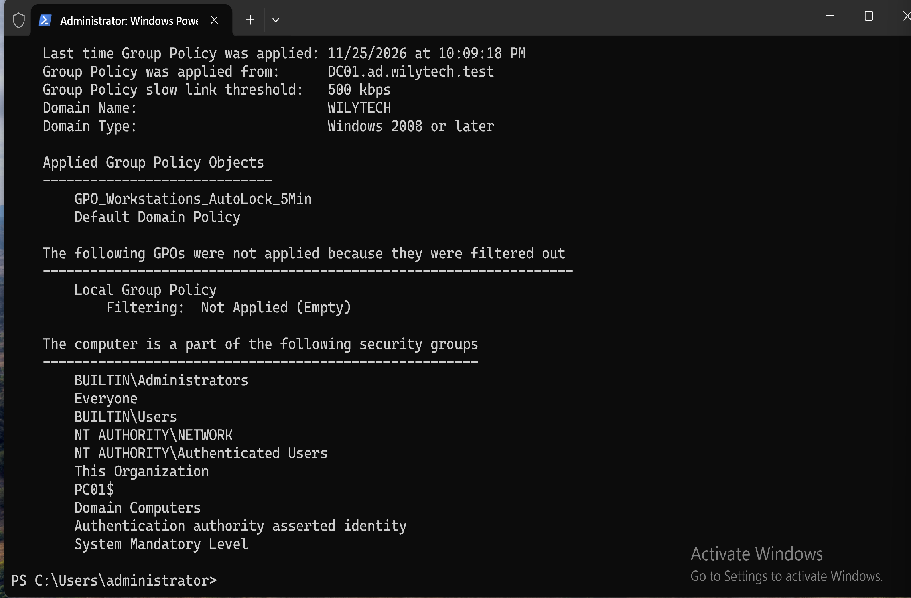

### Automatic Lock Validation

Validated the workstation lock behavior following inactivity.

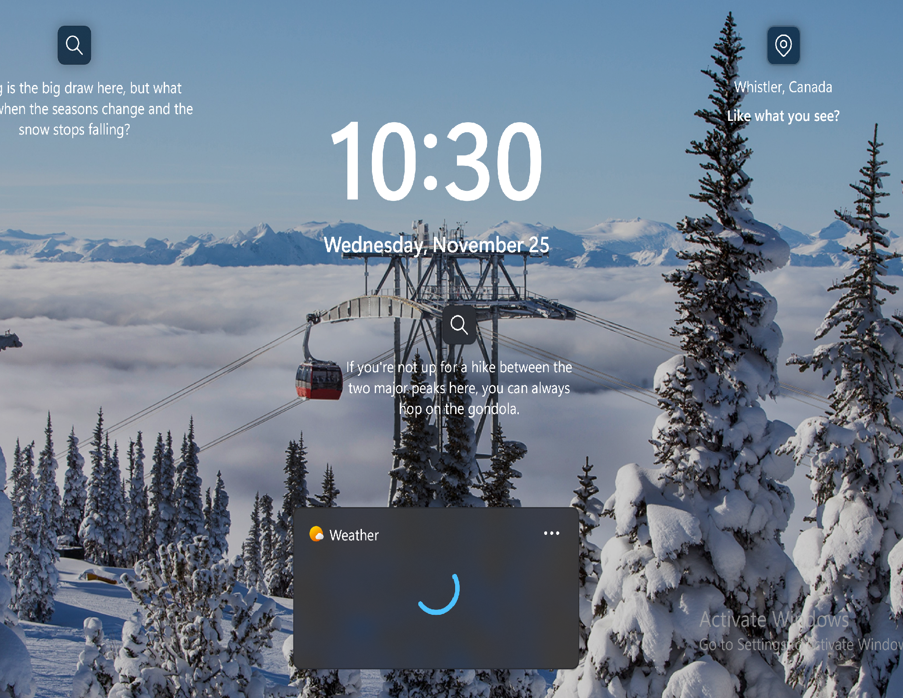

## 4. Customer Service - Security Filtering

Created a department-specific Group Policy Object to restrict Command Prompt access.

- GPO Name: GPO_CustomerService_Block_CMD
- Linked OU: WilyTech-Operations
- Security Filtering: GG_CustomerService_Users
- Domain Computers Permission: Read

Configured GPO permissions to target Customer Service users while allowing domain computers to read the policy.

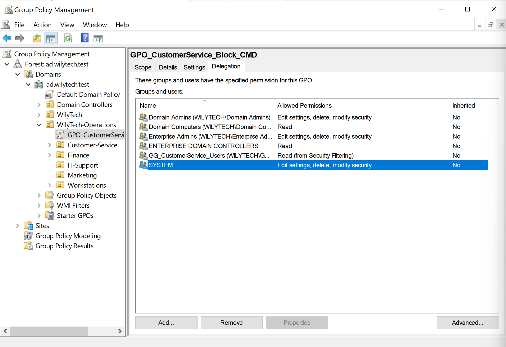

### Command Prompt Restriction

Configured the following user policy:

- Policy: Prevent access to the command prompt
- Status: Enabled
- Command Prompt Script Processing: Disabled

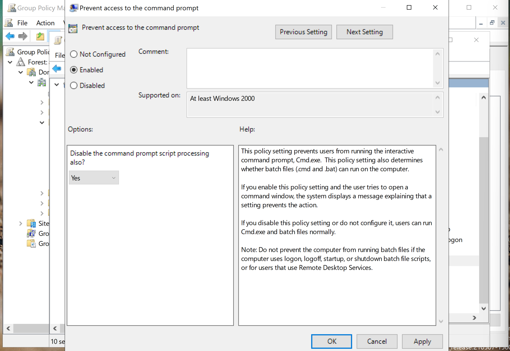

### Restricted User Validation

Logged into PC01 as Gabriel Santos, a Customer Service employee, and confirmed that Command Prompt access was blocked.

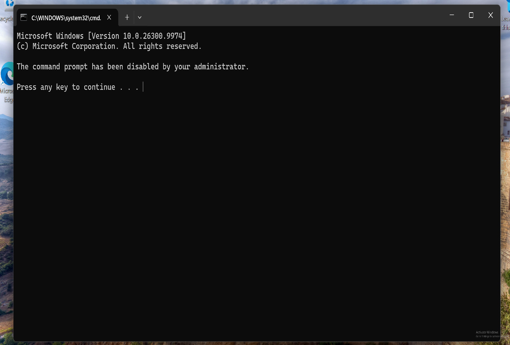

### Non-Targeted User Validation

Logged into PC01 as Laura Mendez from Marketing and confirmed that Command Prompt remained accessible.

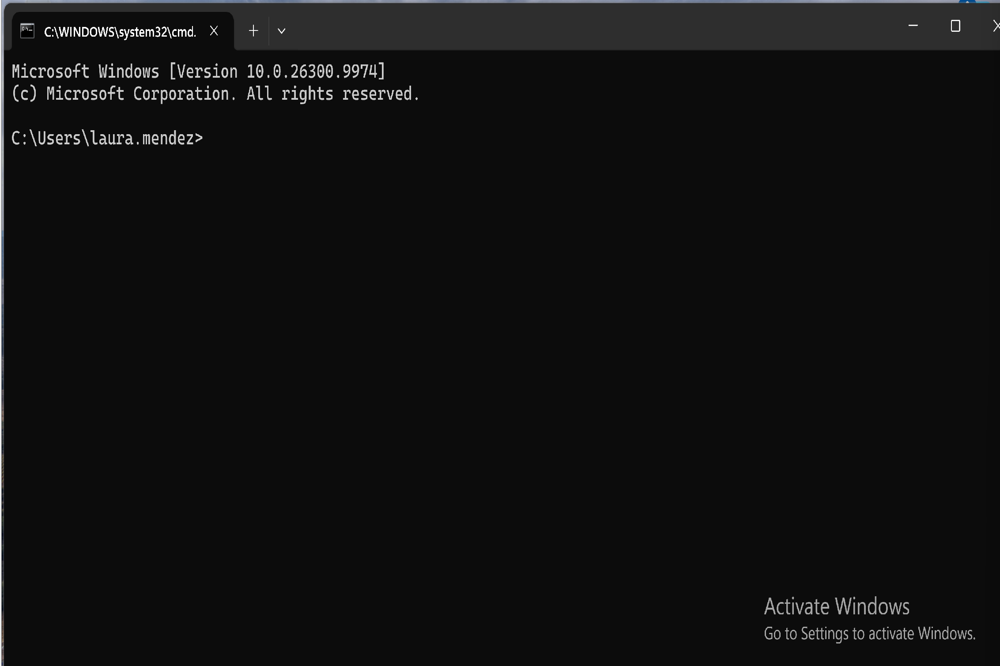

### Security Filtering Verification

Used GPResult to confirm that the Customer Service GPO was excluded from the Marketing user's applied policies.

Result:

```text
GPO_CustomerService_Block_CMD
Filtering: Denied (Security)
```

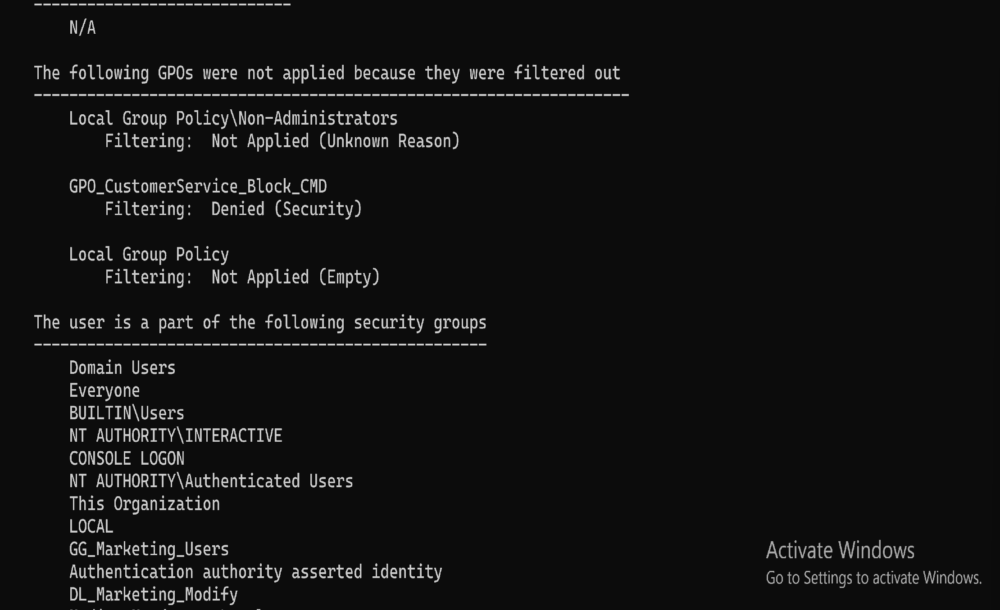

### Final Policy Application Verification

Used PowerShell to verify that Gabriel Santos received the Customer Service GPO and belonged to the appropriate security group.

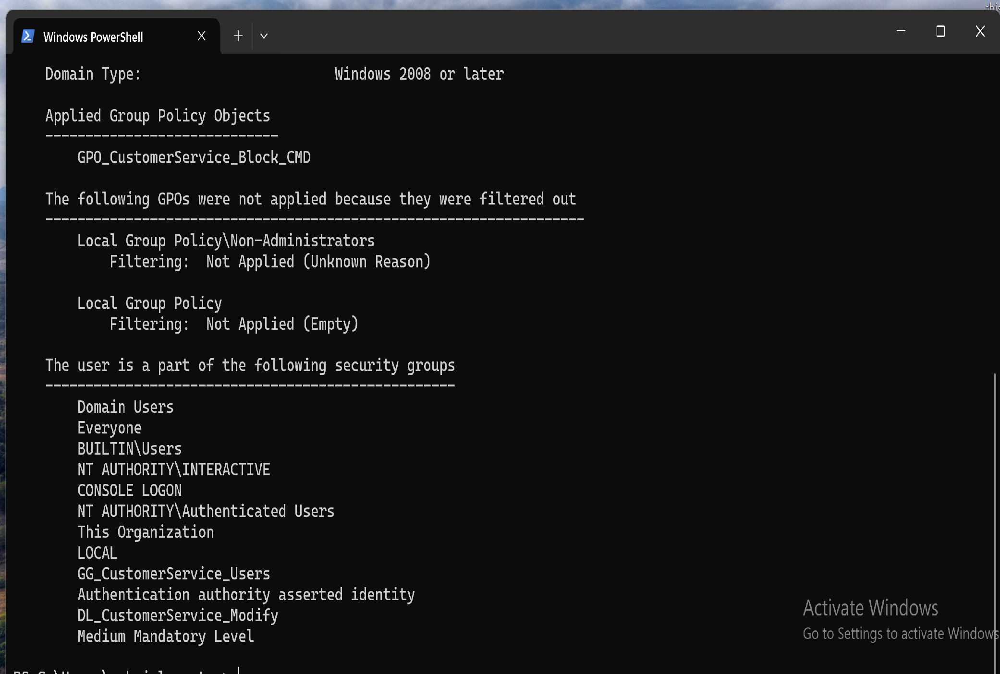

## 5. Validation Results

| Test | Expected Result | Status |
|---|---|---|
| Finance Control Panel Access | Blocked | Passed |
| Marketing Control Panel Access | Allowed | Passed |
| Workstation Automatic Lock | Enabled | Passed |
| Customer Service CMD Access | Blocked | Passed |
| Marketing CMD Access | Allowed | Passed |
| Security Filtering | Correct policy targeting | Passed |
| User GPO Verification | Successfully applied | Passed |
| Computer GPO Verification | Successfully applied | Passed |

## 6. Tools and Technologies

- Windows Server 2022
- Windows 11 Pro
- Active Directory Domain Services
- Group Policy Management Console
- Active Directory Users and Computers
- Organizational Units
- Security Groups
- Security Filtering
- Windows PowerShell
- Command Prompt
- GPUpdate
- GPResult
- VMware Workstation

## 7. Skills Demonstrated

- Group Policy creation and administration
- GPO linking and organizational targeting
- User and computer policy configuration
- Department-specific access restrictions
- Workstation security administration
- Security Filtering implementation
- GPO permission management
- Group Policy troubleshooting
- Policy application and exclusion verification
- Enterprise endpoint security management
- Technical documentation

## 8. Security Considerations

Blocking Command Prompt does not automatically block PowerShell or other command-line tools. Additional application control policies may be required in production environments.

Administrative privileges remain controlled by user permissions and security group memberships.

## Conclusion

Successfully implemented and validated centralized Group Policy management in a simulated enterprise Active Directory environment.

This lab demonstrates practical experience in department-specific policy enforcement, workstation security, security group targeting, and Group Policy troubleshooting.

All tested policies behaved as expected for the selected users and workstation.

---

**Project:** WilyTech Active Directory Infrastructure

**Lab:** 04 - Group Policy Administration

**Status:** Completed

**Author:** Wily-IT-Labs
